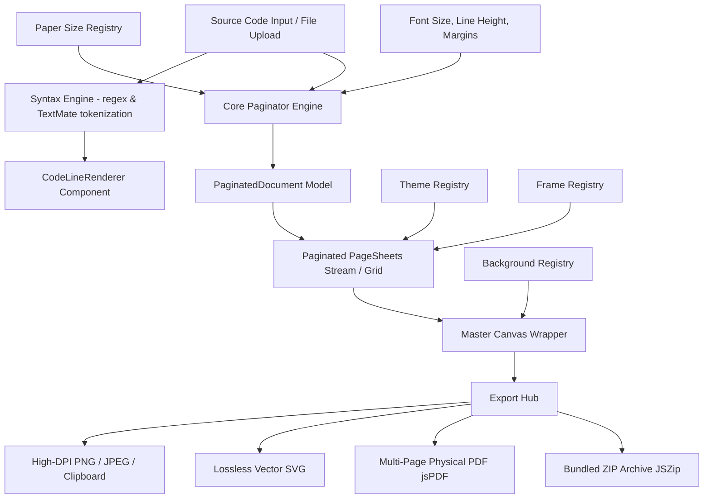

# DevPaper — Engineering Architecture Specification

DevPaper combines high-aesthetic code snippet generation (**ray.so**, **Carbon**, **Glyph**) with a document-grade code pagination and typesetting engine (**Google Docs / MS Word for code**). This document outlines the technical design, subsystem boundaries, data contracts, and export pipelines.

---

## 1. System Architectural Overview

---

## 2. Decoupled Subsystem Boundaries

DevPaper isolates its business logic, visual registries, and UI components into strictly bounded modules:

| Subsystem | Path | Description |
| :--- | :--- | :--- |
| **Registries** | `src/registries/` | Declarative plugin registries for themes, fonts, frames, and paper formats behind runtime validation schemas (`validateTheme`, `validateFont`, `validatePaperPreset`). |
| **Pagination Engine** | `src/core/paginator.ts` | Pure, deterministic mathematical calculation of code flow across physical/presentation sheets based on millimeters, DPI, margins, font metrics, and block heuristics. |
| **Syntax Engine** | `src/core/syntax.ts` | Universal tokenizer mapping source tokens to active theme variables, auto-detecting language, and handling diff markers (`+` / `-`). |
| **Export Engines** | `src/core/exporters/` | Client-side export modules for High-DPI PNG, lossless SVG, physical multi-page PDF (`jspdf`), and sequential ZIP bundling (`jszip`). |
| **Canvas & Sheets** | `src/components/canvas/` | Window chrome, traffic lights, continuous line gutters, and running headers/footers. |
| **Floating Dock** | `src/components/dock/` | Floating control dock providing dark-mode-first controls, theme swatches, typography sliders, and export options. |

---

## 3. Intelligent Pagination Engine

The pagination calculator in `src/core/paginator.ts` avoids superficial screenshot slicing by evaluating layout constraints before rendering.

### A. Physical Dimension Calculation
For any preset paper size (e.g., A4: $210 \times 297\text{ mm}$):
$$\text{Width}_{\text{usable}} = \text{Width}_{\text{total}} - \text{Margin}_{\text{left}} - \text{Margin}_{\text{right}} - \text{Gutter}_{\text{line numbers}}$$
$$\text{Height}_{\text{usable}} = \text{Height}_{\text{total}} - \text{Margin}_{\text{top}} - \text{Margin}_{\text{bottom}} - \text{Height}_{\text{header}} - \text{Height}_{\text{footer}}$$

### B. Line Capacity & Font Metrics
Given font size $F_s$ and line height multiplier $L_h$:
$$\text{LineHeight}_{\text{px}} = \max(14, F_s \times L_h)$$
$$\text{LinesPerPage} = \left\lfloor \frac{\text{Height}_{\text{usable}}}{\text{LineHeight}_{\text{px}}} \right\rfloor$$

### C. Block-Boundary Preservation Heuristic
When `preserveBlocks` is active:
- Scans for opening block declarations (`export function`, `class`, `interface`, `{`, `def `, `pub fn`).
- If an opening declaration occurs within 2 lines of the page capacity threshold, the page break is triggered **before** the declaration rather than stranding the header alone at the page bottom.

### D. Continuous Line Numbering
Lines maintain accurate original source file indices across page boundaries (e.g., Page 1: lines 1–48; Page 2: lines 49–96).

---

## 4. Multi-Page Export Pipeline

### A. High-DPI Image & Clipboard Pipeline
1. Uses `html-to-image` with `pixelRatio` multiplier (2.0 for Retina, 3.0 for print sharpness).
2. Directly writes image blobs to the OS clipboard via `navigator.clipboard.write([new ClipboardItem({ 'image/png': blob })])`.

### B. Merged Multi-Page PDF Pipeline
1. Renders each paginated sheet element (`.devpaper-sheet`) to an in-memory high-DPI canvas buffer.
2. Initializes `jsPDF` configured with physical dimensions in millimeters matching the selected paper preset (e.g., `unit: 'mm'`, `format: [210, 297]` for A4).
3. Adds sequential pages (`pdf.addPage(...)`) and draws high-resolution raster buffers with exact physical alignments.
4. Injects PDF document metadata (title, author, subject, generator).

### C. Bundled ZIP Archive Pipeline
1. Captures all pages sequentially as `image/png` base64 strings or SVG XML strings.
2. Formats sequential zero-padded file names: `${filename}-page-01.png`, `${filename}-page-02.png`, etc.
3. Compresses the archive client-side using `JSZip` into a downloadable `.zip` file.

